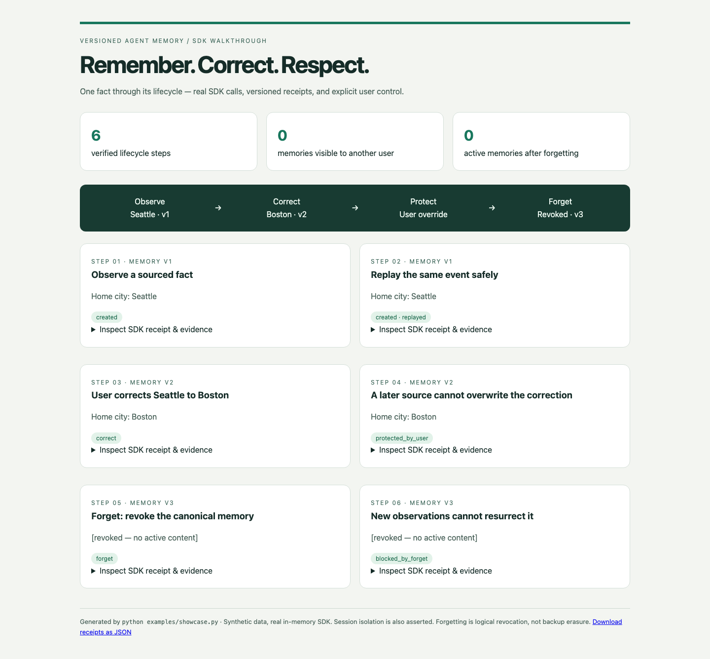
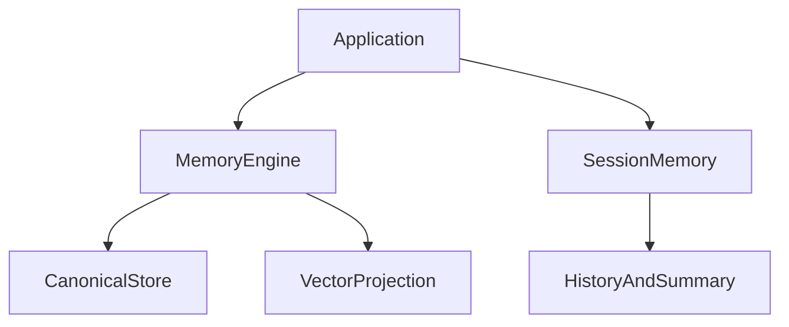

<div align="center">

# Versioned Agent Memory

Formerly **Agent Memory Kit**. Repository branding has changed; Python package names, imports and CLI commands remain compatible.

**Versioned memory. Explicit corrections. Isolated sessions.**

[](https://www.python.org/) [](LICENSE) [](docs/architecture.md) [](https://github.com/Elyon0517/versioned-agent-memory/stargazers)

Find this useful? Give it a star ⭐

[English](README.md) · [简体中文](README.zh-CN.md) · [Architecture](docs/architecture.md) · [Examples](examples) · [Validation](docs/validation.md)

</div>

## See a fact change without losing control



An agent remembers **Seattle**. The user corrects it to **Boston**. A later source still says
Seattle — the SDK preserves the user's correction. After forgetting, later observations
cannot resurrect the revoked memory. Another user sees neither the fact nor the session.

This executable walkthrough uses the real in-memory SDK, including receipts, evidence,
version checks and assertions. Expand a card in the generated HTML to inspect its receipt.

**Observe → replay → correct → protect → forget → block resurrection.** No API key, database or model download is needed.

### Run the visual walkthrough

```bash
git clone https://github.com/Elyon0517/versioned-agent-memory.git
cd versioned-agent-memory
python -m venv .venv
source .venv/bin/activate
pip install -e .
python examples/showcase.py
# Open docs/showcase/index.html in your browser
```

The HTML report and JSON are generated locally; they are not a hosted service.
[Reproduce the browser checks and screenshot](docs/SHOWCASE.md).



## Purpose

An independent SDK for long-term and session memory. Agent Context Builder consumes this component for context orchestration; Agent Strategy Eval evaluates strategies separately. The long-term memory kernel is extracted from the previously published Agent Context Builder implementation, preserving its provenance and validation contracts.

## Install and try

```bash
pip install "agent-memory-kit @ git+https://github.com/Elyon0517/versioned-agent-memory.git@v0.1.0"
```

```python
from agent_memory_kit import MemoryEngine, Observation, Scope, Message, SessionMemory
from agent_memory_kit.adapters import InMemoryStore

scope = Scope("demo", "user-1")
engine = MemoryEngine(InMemoryStore())
engine.observe(
    scope, Observation("event-1", "preference", 1, "Vegetarian meals", ("settings:1",))
)
sessions = SessionMemory()
sessions.append(scope, "chat-1", Message("m1", "user", "Plan dinner"), ttl=3600)
print(engine.active(scope)[0].content)
```

## Capabilities

- Evidence-backed long-term memory, source versions and idempotent events.
- User correction protection, logical forgetting and canonical retrieval validation.
- MongoDB aggregate storage and a reference cosine vector adapter.
- Tenant/user/session isolation, message replay checks and fixed session TTL.
- Injectable summaries with revision checks against concurrent mutations.

## Scope and limitations

Session storage is process-local and synchronous. Session TTL expires the whole session; long-term memories do not yet expire automatically. Confidence is not a general importance score. Summaries are supplied by your callback; no model or automatic extraction is bundled. Forgetting is logical revocation, not guaranteed erasure of backups. Canonical aggregates and session histories grow without compaction. Remote vector adapters, production session persistence and ranking research remain future work.

## Development

```bash
python -m venv .venv
source .venv/bin/activate
pip install -e '.[dev,mongo]'
pytest -q
ruff check .
mypy
```

## License

Licensed under the [MIT License](LICENSE).

Copyright © 2026 Honghao Li.

## Source, copyright and attribution

Original project: [Elyon0517/versioned-agent-memory](https://github.com/Elyon0517/versioned-agent-memory), maintained by
[Elyon0517](https://github.com/Elyon0517). Project code is available under the [MIT License](LICENSE), subject to file-specific and third-party notices. Redistributions must preserve the applicable copyright and permission notices.

For articles, demos and derivatives, please credit the original project and link here.
That link is a courtesy request, not an extra restriction on an existing open-source license.
See [copyright and third-party boundaries](COPYRIGHT.md) and [citation metadata](CITATION.cff).
