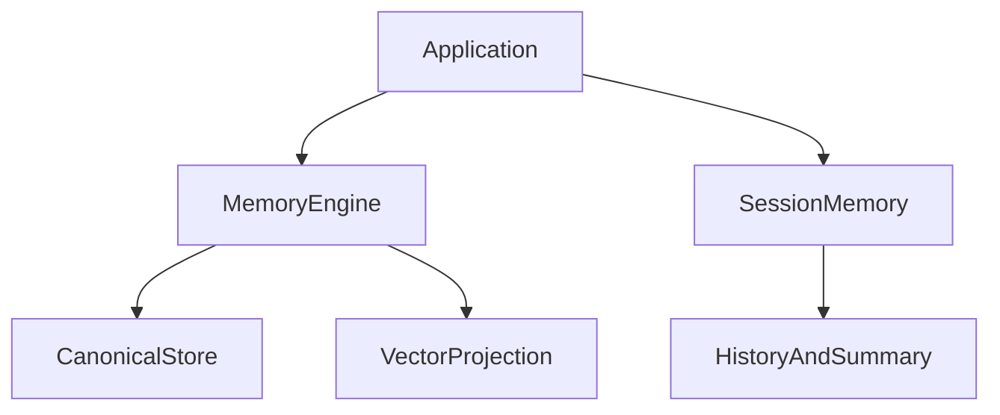

<div align="center">

# Versioned Agent Memory

原名 **Agent Memory Kit**。本次调整仓库名称；Python 包名、import 路径和 CLI 命令保持兼容。

**Versioned memory. Explicit corrections. Isolated sessions.**

[](https://www.python.org/) [](LICENSE) [](docs/architecture.md) [](https://github.com/Elyon0517/versioned-agent-memory/stargazers)

喜欢这个项目？请点一个 Star ⭐

[English](README.md) · [简体中文](README.zh-CN.md) · [Architecture](docs/architecture.md) · [Examples](examples) · [Validation](docs/validation.md)

</div>



## 定位

独立的长期记忆与会话记忆 SDK。Agent Context Builder 通过接口接入本组件，负责上下文编排；Agent Strategy Eval 独立评估策略。长期记忆内核从已发布的 Agent Context Builder 开源实现迁移，保留原有验证与来源追踪设计。

## 安装与示例

```bash
pip install "agent-memory-kit @ git+https://github.com/Elyon0517/versioned-agent-memory.git@v0.1.0"
```

```python
from agent_memory_kit import MemoryEngine, Observation, Scope, Message, SessionMemory
from agent_memory_kit.adapters import InMemoryStore

scope = Scope("demo", "user-1")
engine = MemoryEngine(InMemoryStore())
engine.observe(
    scope, Observation("event-1", "preference", 1, "Vegetarian meals", ("settings:1",))
)
sessions = SessionMemory()
sessions.append(scope, "chat-1", Message("m1", "user", "Plan dinner"), ttl=3600)
print(engine.active(scope)[0].content)
```

## 当前能力

- 长期记忆支持证据、来源版本、事件幂等、用户纠正和逻辑遗忘。
- 支持 MongoDB 存储及参考向量索引，检索结果回查权威存储。
- 会话按租户、用户、会话隔离，支持消息去重、固定 TTL 和摘要回调。
- 摘要生成期间发生修改、删除或过期时，拒绝写入旧摘要。

## 边界与限制

会话存储目前仅驻留进程内，采用同步接口；TTL 针对整个会话，长期记忆暂不自动过期。confidence 不等于重要性评分。摘要由调用方提供，未内置模型或自动提取。遗忘属于逻辑撤销，不保证备份数据物理删除。数据尚无自动压缩；持久化会话、远程向量适配与高级评分属于后续工作。

## Development

```bash
python -m venv .venv
source .venv/bin/activate
pip install -e '.[dev,mongo]'
pytest -q
ruff check .
mypy
```

## License

本项目采用 [MIT License](LICENSE)。

Copyright © 2026 Honghao Li.

## 可运行的可视化演示


在仓库根目录安装项目后执行 `python examples/showcase.py`，打开生成的
`docs/showcase/index.html`。演示由真实 SDK 调用生成，不需要 API key 或数据库。
展示观察、重放、用户纠错保护、遗忘与隔离，卡片可展开查看证据和回执。

复现浏览器测试与截图的命令见 [SHOWCASE.md](docs/SHOWCASE.md)。

## 来源、版权与署名

原始仓库：[Elyon0517/versioned-agent-memory](https://github.com/Elyon0517/versioned-agent-memory)。
许可及第三方材料边界见 [COPYRIGHT.md](COPYRIGHT.md)，引用信息见 [CITATION.cff](CITATION.cff)。
请按适用许可证保留版权和许可声明；文章或演示中附上原仓库链接是署名建议，
不构成对已有开源许可的额外限制。使用或提及本项目不代表作者为相关产品背书。
